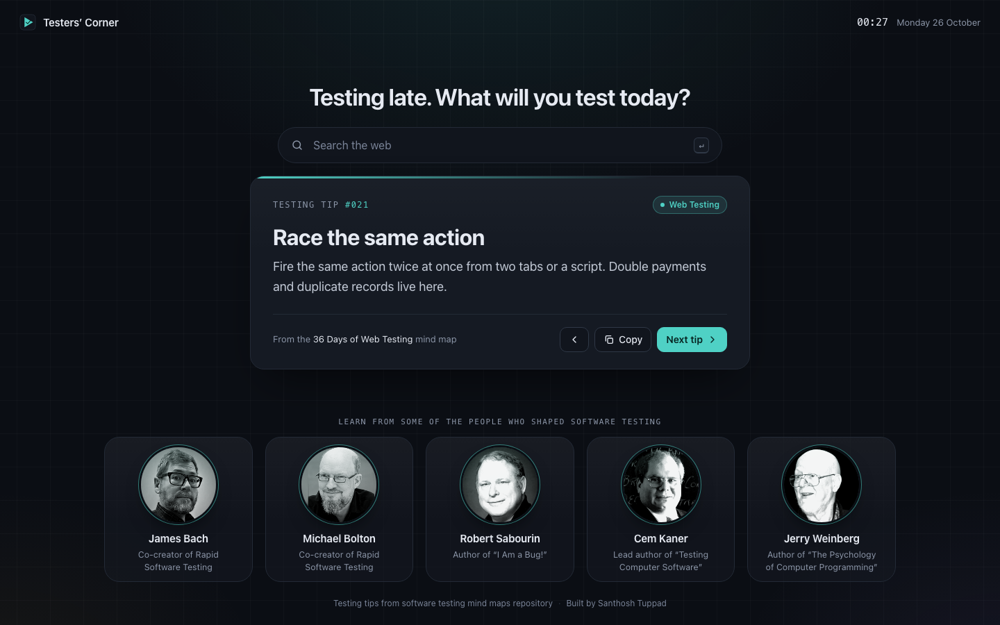

# Testers’ Corner

A dark Chrome theme for software testers, plus a New Tab page that shows a fresh testing tip every time you open a tab.

**Code:** https://github.com/ondsectest/apps/tree/main/Testers%20Corner

**Demo video (42 seconds):** [demo/testers-corner-demo.mp4](demo/testers-corner-demo.mp4)



## What's inside

| Part | Where | What it does |
| --- | --- | --- |
| **Testers’ Corner** (theme) | this folder: [`manifest.json`](manifest.json) and [`icons/`](icons) | Dark window, tabs, toolbar and address bar with teal accents |
| **Testers’ Corner – New Tab** (extension) | [`new-tab/`](new-tab) | Dark New Tab page with a testing tip, search box and clock |

They're two separate pieces because a Chrome theme can only change colours and can't show changing content. Install both for the full look.

## Get it

**Option 1: Download ZIP (no Git needed)**

1. Go to https://github.com/ondsectest/apps
2. Click **Code** → **Download ZIP**, then unzip it.
3. Everything is in the `Testers Corner` folder inside it.

**Option 2: Clone with Git (only this folder)**

```bash
git clone --depth 1 --filter=blob:none --sparse https://github.com/ondsectest/apps.git
cd apps
git sparse-checkout set "Testers Corner"
```

## Install in Chrome (quick steps)

1. Open `chrome://extensions` and turn on **Developer mode** (top right).
2. **Theme:** click **Load unpacked** and select the `Testers Corner` folder.
3. **New Tab page:** click **Load unpacked** again and select `Testers Corner/new-tab`.
4. Open a new tab. If Chrome asks whether to keep the changed New Tab page, choose **Keep it**.

That's it. Every new tab now shows a testing tip.

**To remove it:** for the theme, go to `chrome://settings/appearance` and click **Reset to default**. For the New Tab page, click **Remove** on its card in `chrome://extensions`.

## The New Tab page

- **114 testing tips** from five software testing mind maps: Web Testing, Test Ideas, Bug Hunting, Tester Growth and Accessibility.
- Tips come from a shuffled deck, so you see every tip once before any tip repeats.
- Keyboard shortcuts: <kbd>→</kbd> next tip, <kbd>←</kbd> previous tip, <kbd>C</kbd> copy the tip, <kbd>/</kbd> jump to search.
- Search uses your browser's default search engine.
- A row at the bottom links to five of the people who shaped software testing: James Bach, Michael Bolton, Robert Sabourin, Cem Kaner and Jerry Weinberg.
- No tracking, no network requests and no remote code. The only permission it asks for is `search`.

## Colour palette

| Role | Colour |
| --- | --- |
| Background | `#0B0E14` |
| Toolbar / surfaces | `#151A23` |
| Text | `#E6EAF2` |
| Muted text | `#8C96A8` |
| Accent (teal) | `#4FD1C5` |
| Web Testing / Test Ideas / Bug Hunting / Tester Growth / Accessibility | `#4FD1C5` / `#A78BFA` / `#F87171` / `#F6B94C` / `#60A5FA` |

Text on the New Tab page meets WCAG AA contrast. Fonts come from your operating system (SF Pro and SF Mono on macOS, Segoe UI Variable on Windows, Roboto on Linux and ChromeOS), so the page loads instantly and works offline.

## Add your own tips

Tips live in [`new-tab/tips.js`](new-tab/tips.js) as one line each:

```js
["bugs", "Short title", "One or two sentences that tell the tester exactly what to try."],
```

The first value is the area: `web`, `ideas`, `bugs`, `growth` or `a11y`. After editing, click the reload icon on the extension card in `chrome://extensions`.

Pull requests with new tips are welcome.

## Add photos to the people row

Each card has room for a large round portrait. Until a photo is added, the card shows the person's initials. Every photo gets the same treatment so the row looks like one set: a square crop at the same size and brightness, a soft black-and-white look with a teal tint, and full colour on hover.

1. Get permission to share each photo publicly, from the person or the photographer.
2. Put the original photos in any folder, named by slug: `james-bach`, `michael-bolton`, `robert-sabourin`, `cem-kaner`, `jerry-weinberg` (`.jpg`, `.png` or `.webp`).
3. Run:

   ```bash
   python3 scripts/prepare_photos.py path/to/that/folder
   ```

   This saves matching 400×400 photos to `new-tab/people/` and fills in [`new-tab/people.js`](new-tab/people.js) for you.
4. Reload the extension in `chrome://extensions`, and credit the photographers in the Credits section below.

## For maintainers

```bash
python3 scripts/make_icons.py   # regenerate icons (needs Pillow)
python3 scripts/prepare_photos.py <folder>   # crop and tone people photos
./scripts/package.sh            # build ZIPs into dist/ (e.g. for a Chrome Web Store upload)
```

When you change anything, bump `version` in both `manifest.json` and `new-tab/manifest.json`.

## Credits

**Built by Santhosh Tuppad.**

The testing tips are based on the software testing mind maps by Santhosh Tuppad / TestInsane:

- *36 Days of Web Testing* (from Rob Lambert, The Social Tester)
- *37 Sources for Test Ideas*
- *50 Bugs / Test Ideas*
- *A Tester's Resolutions*
- *Accessibility Testing Tools*

### Photos

Portraits in the people row come from these pages. Copyright stays with the photographers and publishers.

- James Bach: Google Images thumbnail (original source not recorded)
- Michael Bolton: [rapid-software-testing.com](https://rapid-software-testing.com/)
- Robert Sabourin: [The Test Tribe](https://www.thetesttribe.com/)
- Cem Kaner: [Florida Tech News](https://news.fit.edu/)
- Jerry Weinberg: [Tea-time with Testers](https://teatimewithtesters.com/)

## Licence

[MIT](LICENSE) © 2026 Santhosh Tuppad
