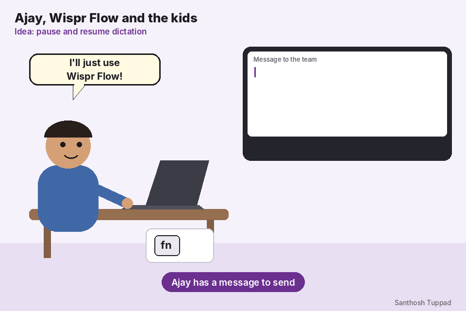

# Pause and Resume Dictation

An improvement request for Wispr Flow, shown as an animated GIF.

## Summary

Real life interrupts dictation. A way to pause Wispr Flow, deal with the interruption, and resume where you stopped would keep one clean message instead of a broken one.

## The story

1. Ajay holds the **fn** key and starts dictating: "Hi team, the release is ready..."
2. His kids run in, talking to him.
3. He taps **Pause** on the Flow Bar and talks to the kids. Nothing he says to them is typed.
4. When they leave, he taps **Resume** and finishes: "...and we ship on Monday."
5. The result is one clean message.

## Why it matters

- People dictate at home, in shared offices and on calls, where interruptions are normal.
- Without a pause, the choice is to keep recording and capture the side conversation, or stop and start a new dictation, which splits the message.
- Side conversations can include private things that should never be typed or stored.

## Suggestion

- A **Pause** button on the Flow Bar while dictating, which turns into **Resume**. A keyboard shortcut and the Flow Bubble on Android could offer the same.
- While paused, the bar clearly shows "Paused", the microphone stops, and no audio is sent, stored or typed.
- Resume continues in the same text field, after the last word.
- Optionally, auto-pause after a long silence, with a quick way to resume.

## Files

| File | What it is |
| --- | --- |
| `Ajay_Pause_and_Resume.gif` | A short looping animation of the idea. |
| `pause-and-resume-dictation.html` | The request as a web page, with the animation embedded and the full details. One self-contained file; open it in any browser. |

## Notes

- Wispr Flow's help docs describe holding fn to dictate; no pause and resume control was found. This is shown as an idea.
- Ajay, his kids and the Flow Bar in the animation are original drawings.

Reported by Santhosh Tuppad.
