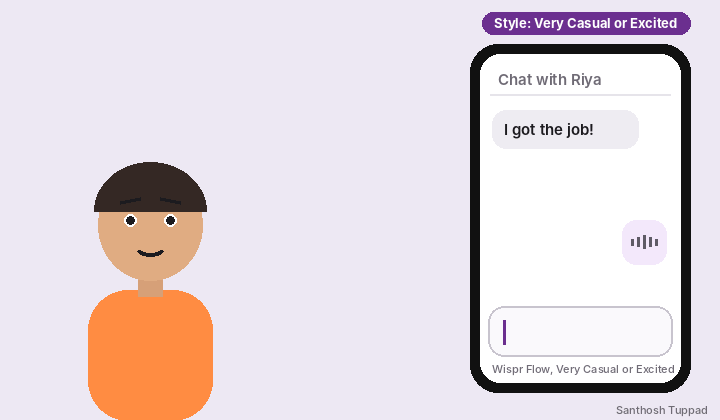

# Stretched Words in Very Casual Style

An improvement request, with a possible bug, for Wispr Flow's **Style** setting on Android.

## Summary

With the style set to **Very Casual** or **Excited**, saying a stretched-out word like "whaaaaaaaat" is always written as the plain word "What". The way it was said is lost.

## Steps to reproduce

Seen on a Vivo 60e phone running Android.

1. Open **Style** and set the style to **Very Casual** (Personal messages) or **Excited**.
2. Open an app in the matching category, for example a messaging app for Very Casual.
3. Dictate "what", drawing it out: "whaaaaaaaat".

## What happens

Flow writes the plain word, "What", without the stretched letters.

## What was expected

In Very Casual or Excited, something closer to how it was said, such as "whaaaaaaaat". Stretched words are a normal part of casual chat; they show surprise, excitement or humour.

## Why it matters

- Chatting with friends, where the tone carries the meaning.
- Group chats and rooms where people write the way they talk.
- Developers who need this kind of text as input for apps they are building.

## Possible bug

Wispr Flow's help docs describe Very Casual as producing all-lowercase text, but in testing the word also came out in capitals ("WHAT").

## Suggestion

In Very Casual and Excited only, keep drawn-out words roughly as spoken, perhaps capped at a sensible length such as 3 to 8 repeated letters. Formal and Casual would keep writing the normal word.

## Files

| File | What it is |
| --- | --- |
| `Whaaat_vs_What.gif` | A short looping animation of the issue: what was said, what Flow typed, and the style used. |

## Notes

- Very Casual is available for Personal messages only, and Excited for Work messages, Email and Other apps, according to Wispr Flow's help docs, so test each style in the matching kind of app.
- The person and the chat in the animation are original drawings.

Reported by Santhosh Tuppad.
