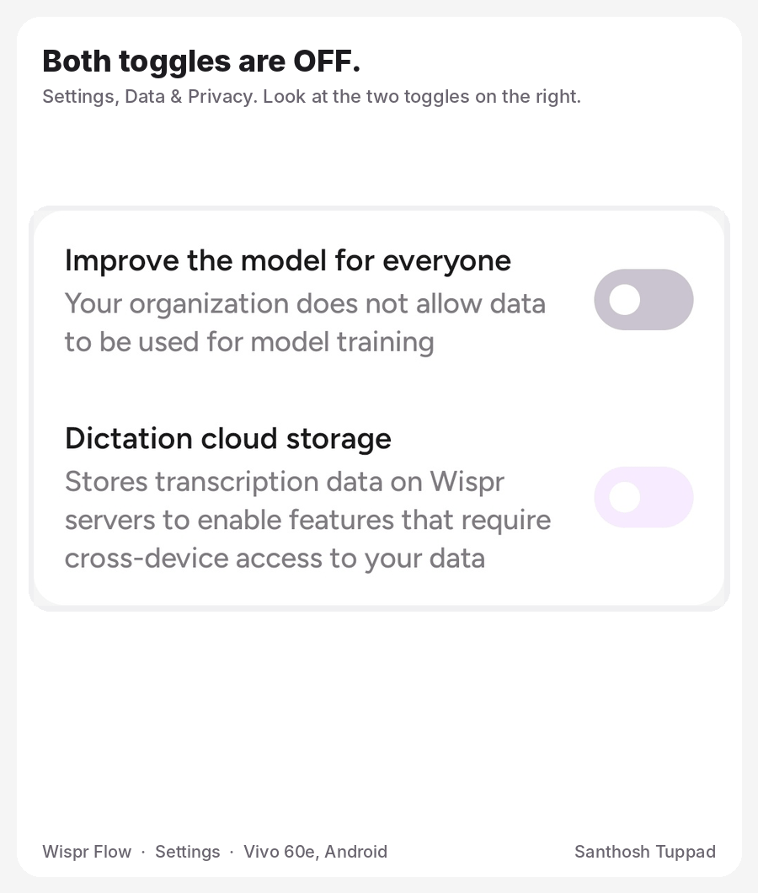

# Two OFF Toggles, Two Colours

A UI bug in Wispr Flow's **Settings, Data & Privacy** on Android.

## Summary

Both toggles in Data & Privacy are off, but they use different colours. The light purple one looks turned on, because next to it the grey one looks like the only real off.

## Steps to reproduce

Seen on a Vivo 60e phone running Android.

1. Use an account where the organization does not allow data to be used for model training.
2. Make sure **Dictation cloud storage** is off.
3. Open **Settings** and scroll to **Data & Privacy**.
4. Compare the two toggles.

## What happens

- **Improve the model for everyone** is off and shown in grey.
- **Dictation cloud storage** is also off, but shown with a light purple tint.
- Purple is the app's accent colour, so the cloud storage toggle reads as on.

## What was expected

Two toggles in the same state look the same. Off is one colour everywhere, and purple is used only when a toggle is on.

## Proposed fix

- Every off toggle uses the same neutral grey.
- A locked toggle is shown with a lock icon and its "Your organization does not allow..." text, not with a different colour.
- Purple is used only for toggles that are on.

## Files

| File | What it is |
| --- | --- |
| `Toggle_Off_Colour_Confusion.gif` | A short looping animation built from a screenshot of the app: both toggles, why the purple one looks on, and the proposed fix. |
| `two-off-toggles-two-colours.html` | The report as a web page, with the animation embedded and the full details. One self-contained file; open it in any browser. |

## Notes

- This is a separate issue from [Better UX: Explaining Settings Locked by an Admin](../Better%20UX%20Explaining%20Settings%20Locked%20by%20an%20Admin), which is about explaining why a setting is locked.

Reported by Santhosh Tuppad.
